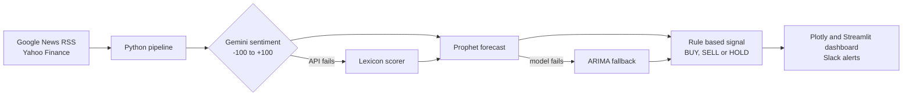

 

 

---

## At a glance

| | |
|---|---|
| **Role I am looking for** | AI Engineer, GenAI Engineer, LLM Application Developer |
| **What I do** | Build LLM apps, RAG pipelines and data services in Python |
| **Experience** | Two AI internships in 2025, four projects with public code |
| **Education** | B.Tech, Computer Science and Engineering, 2024 |
| **Also learning** | Solana development with Rust and Anchor (Turbin3 Q3 2026 cohort, Solana Fall School) |
| **Reach me** | gopichandchalla516@gmail.com |

---

## About me

I am an AI engineer from Guntur, India. I graduated in 2024 with a B.Tech in Computer Science and Engineering, and in 2025 I completed two AI internships: Data Science with GenAI at Innomatics Research Labs, and AI at Infosys Springboard.

I like the part of AI work where a model has to fit inside a real service. That means structured outputs, a fallback for when an API call fails, authentication, and a deployment someone else can call. Most of my projects follow that pattern. Data comes in messy, an LLM or a model reads it, and the service returns a decision with a reason attached.

I learn by building and I keep my code public. Alongside the AI work, I am learning Solana development with Rust and Anchor. I was selected for Solana Fall School and I am part of the Turbin3 Q3 2026 Builders cohort. I am also working through 100 Days of Solana in public, at 78 of 100 days so far.

I am looking for an AI engineer role at an early stage company where I can build, ship and learn quickly. I can work remotely or relocate.

---

## Tech stack

| Area | Tools |
|---|---|
| **AI and ML** | Gemini API, OpenAI API, LangChain, prompt engineering, embeddings, RAG, scikit-learn, Prophet, ARIMA |
| **Languages** | Python, SQL, TypeScript, JavaScript, Java, Rust |
| **Backend** | FastAPI, REST APIs, Pydantic, API key auth, Next.js, Streamlit |
| **Data** | Pandas, NumPy, Plotly, Matplotlib, PostgreSQL, MySQL, MongoDB, feedparser, yfinance |
| **Web3** | Solana, Anchor, Token-2022, PDAs, CPIs, LiteSVM |
| **Tools and hosting** | Git, GitHub, Jupyter, Google Colab, Vercel, Render |

---

## Featured AI projects

<table>
<tr>
<td width="50%" valign="top">

### NovaAI Nexus
**Scam detection honeypot API**

FastAPI service that checks messages for scams and phishing, keeps multi turn sessions, and returns JSON with signals, confidence and a reason. Detection is rule based. Regex pulls out UPI IDs, bank accounts and phishing links, and results post to the organiser's callback endpoint.

`Python` `FastAPI` `Pydantic` `Render`

India AI Impact Buildathon 2026

[Source](https://github.com/gopichandchalla16/novaai-nexus-honeypot) | [API docs](https://novaai-nexus-honeypot.onrender.com/docs)

</td>
<td width="50%" valign="top">

### AI-Sentinel
**LLM risk analyzer for Solana**

Sends on-chain data from Helius to Gemini with structured prompts and parses the JSON risk verdict. Six API routes: analysis, wallet profiling, program scan, threat feed, follow up chat and wallet history. A rule based fallback runs if the LLM call or parsing fails.

`Next.js` `TypeScript` `Gemini` `Vercel`

Colosseum Frontier Hackathon 2026

[Source](https://github.com/gopichandchalla16/AI-Sentinel) | [Live demo](https://ai-sentinel-three.vercel.app)

</td>
</tr>
<tr>
<td width="50%" valign="top">

### Real-Time Industry Insight System
**Market sentiment and forecasting pipeline**

Built in a team of four during my Infosys Springboard internship. Pulls Google News RSS and Yahoo Finance data, scores sentiment with Gemini from -100 to +100, forecasts with Prophet, and produces a rule based BUY, SELL or HOLD signal. Plotly and Streamlit dashboard with Slack alerts.

`Python` `Gemini` `Prophet` `Streamlit` `Plotly`

[Source](https://github.com/gopichandchalla16/infosys-internship-real-time-industry-insight-system)

</td>
<td width="50%" valign="top">

### AI Code Reviewer
**Run and debug Python with Gemini**

A Streamlit app where you write and run Python code, then ask Gemini to explain, debug or improve it. You bring your own Gemini API key.

`Python` `Streamlit` `Gemini API`

[Source](https://github.com/gopichandchalla16/AI-Code-Reviewer) | [Demo](https://syntax-surgeon.streamlit.app/)

</td>
</tr>
</table>

---

## How my projects work

Both the Infosys system and NovaAI follow the same idea: take messy input, get a structured result, and keep working when a part fails.

---

## Experience

| When | Role | What I did |
|---|---|---|
| **Oct 2025 to Dec 2025** | **AI Intern, Infosys Springboard** | Worked on a Python market intelligence pipeline with a team of four. Built Gemini sentiment scoring with an automatic fallback, added Prophet forecasting with an ARIMA fallback, and delivered a Plotly and Streamlit dashboard with Slack alerts. |
| **Jan 2025 to Apr 2025** | **Data Science with GenAI Intern, Innomatics Research Labs** | Built LLM apps and chatbots with LangChain, OpenAI APIs and Streamlit. Used prompt engineering, embeddings and RAG, and trained and evaluated models with scikit-learn, Pandas and NumPy. |

---

## Solana and Web3

I build on Solana as a second track. The Rust and Anchor work comes from the Turbin3 cohort and Solana Fall School.

| Project | What it is |
|---|---|
| [Solana Escrow](https://github.com/gopichandchalla16/turbin3-escrow-q3-26) | Token swap program in Rust and Anchor with refunds, updates and expiry. Works with SPL Token and Token-2022. |
| [Transfer Hook](https://github.com/gopichandchalla16/solana-fall-transfer-hook) | Token-2022 transfer hook that rate limits transfers using PDA state and CPIs. |
| [100 Days of Solana](https://github.com/gopichandchalla16/100-days-of-solana) | Public build log, 78 of 100 days so far. |
| [PrivateCredit AI](https://github.com/gopichandchalla16/privatecredit-ai-midnight) | Prototype where AI scores credit data and a lender checks a threshold result without seeing the data. Uses Midnight and ZK. |
| [TipLink Live](https://github.com/gopichandchalla16/tiplink-live) | Creator tipping app in Next.js with Solana Actions routes and Gemini thank you messages. |

---

## Certifications

---

## GitHub activity

---

## Writing

- [CPI on Solana: The Mental Model I Wish I Had on Day 71](https://dev.to/gopichand_dev/cpi-on-solana-the-mental-model-i-wish-i-had-on-day-71-ceh)
- [What I Learned About PDAs in a Week of Building on Solana](https://dev.to/gopichand_dev/what-i-learned-about-pdas-in-a-week-of-building-on-solana-4n9b)

---

## Let's talk

If you are hiring for an AI engineer role, or building something with LLMs, I would like to hear about it. Email is the fastest way to reach me.

